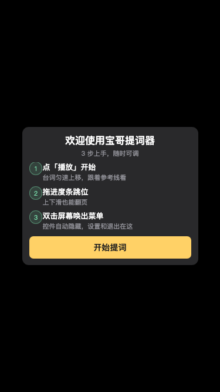
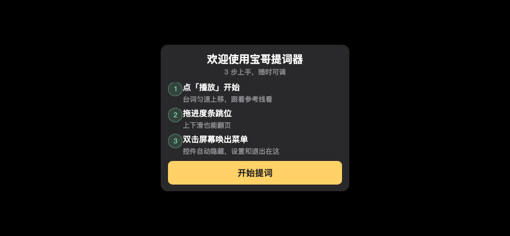
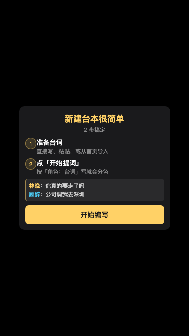
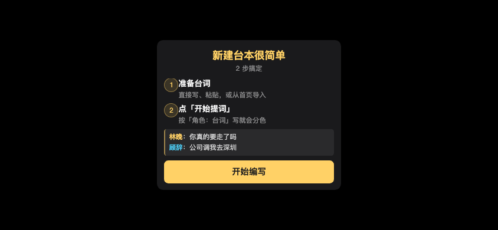

# 三项调整：实现点与影响范围

> 日期：2026-10-27　｜　工程：`宝哥提词器/baoge-teleprompter`　｜　提交：`2cd82ad`
> 本文不依赖任何对话上下文，可独立阅读。

---

## 零、一句话结论

三项需求里，**第 1 项早就做完了**，**第 2 项只做了表面**（改了默认值、入口全留着），
**第 3 项做了尺寸、没做流程**。真正需要动手的是后两项。

| # | 需求 | 实际状态 | 本轮改动 |
|---|---|---|---|
| 1 | 默认滚动速度 50 | ✅ 09-29 已完成 | 仅核查，0 行代码 |
| 2 | 取消「名字+台词」同时高亮 | ⚠️ 默认值改了，`full` 仍可点回去 | 4 处收敛，代码 +83/−41 |
| 3 | 优化新人引导流程 | ⚠️ 尺寸已优化，流程感未解决 | 2 页引导改造 |

---

## 一、默认滚动速度 50

### 1.1 实现点（完整链路，缺一环就会「改了不生效」）

| 环节 | 位置 | 现值 |
|---|---|---|
| 默认值 | `miniprogram/engine/prefs.js` → `DEFAULTS.speed` | `50` |
| 预设档位 | 同文件 `SPEED_PRESETS[0]` | `{ label: '极慢', value: 50 }` |
| 读取合并 | `load()` = `Object.assign({}, DEFAULTS, saved)` | `saved` 在后 ⇒ 老用户不被覆盖 |
| 速度换算 | `pages/teleprompter/teleprompter.js` → `pxPerSecondOf` | `max(24, speed × 0.6)` ⇒ 50 档 = **30 px/s** |
| 页面初值 | 同文件 `data.speed` | `50`（与 DEFAULTS 同值） |
| 加/减速兜底 | `pages/settings/settings.js` → `onStepSpeed` | 走 `DEFAULTS.speed`，**已不是 `\|\| 200`** |

`SPEED_MIN = 40`、`SPEED_MAX = 400`。

### 1.2 影响范围

- **新装用户**：打开即「极慢 50」档，30 px/s 匀速上滚。
- **老用户**：**零影响**。存档里有 `speed` 字段，`saved` 覆盖 `DEFAULTS`。
  这是 `load()` 注释里写死的「不变式，勿改」。
- **数据迁移**：**不做，也不该做**。为这档写迁移会把老用户调好的速度冲掉，
  这是需求明确禁止的行为。

### 1.3 一个设计后果，值得提前知道

`50` 落在 `40–400` 区间的 **2.8%** 处 —— 默认值基本贴着最慢端。
用户想更慢只剩 10 档余地，想正常语速几乎只能一直往上加。

这是「默认宁慢勿快」的取舍，不是 bug。若以后收到「默认太慢」的反馈，
**改的是 `DEFAULTS.speed` 一个数，不要去动 `SPEED_PRESETS` 数组**（否则「极慢」档和默认值会分家，
`speed_preset.test.js` 里那条「极慢 === 默认值」的断言会立刻红）。

---

## 二、取消「名字+台词」同时高亮

### 2.1 为什么说上一轮「只做了表面」

09-29 那次把 `DEFAULTS.roleHighlightMode` 从 `'full'` 改成了 `'name'`，
测试也断言了「默认是 name」—— 从外面看像是已经取消了。实际上：

| 位置 | 改默认值之前 | 改默认值之后 |
|---|---|---|
| 提词台菜单 | 两个互斥按钮 | **仍是**两个互斥按钮，`full` 随时能点回去 |
| 编辑页 | 两个 `seg-btn` | **仍是**两个 `seg-btn` |
| 渲染层 | `bodyColor = mode === 'full' && roleColor ? roleColor : eff.text` | **仍是**这个分支 |

**「改默认值」和「取消一种模式」是两件完全不同的事。**
前者只影响没做过选择的人；后者要清掉入口 + 渲染分支 + 老存档残留。
只改默认值，等于给用户留了一个默认不亮、但随时能点亮的开关。

### 2.2 实现点：四处一起断，断一处就留一条复活路径

#### ① 数据层归一 —— `miniprogram/engine/prefs.js`

```js
function normalize(p) {
  ...
  // 无条件归一：老存档里的 'full'（含 smartOffSaved 快照里的）一律变 'name'
  p.roleHighlightMode = 'name'
  ...
}
```

⚠️ **只归「方式」，不动 `roleHighlight` 这个开关。**
用户"要不要分色"的选择必须原样保留，被下线的只是"分到什么范围"。
这两件事混起来会误关用户的高亮 —— 这是本项最容易写错的地方。

#### ② 提词台：两个模式按钮 → 一个开/关

| 项 | 改前 | 改后 |
|---|---|---|
| WXML | `名字高亮` / `名字+台词` 两个 `tp-btn` | 一个 `{{roleHighlight ? '高亮 开' : '高亮 关'}}` |
| 事件 | `onSetRoleMode` + `data-mode` | `onToggleRoleHighlight` |
| 联动 | 直接 `updatePrefs({roleHighlightMode})` | 走 `smartPatch(cur,'roleHighlight',next)`，与智能总闸联动 |

理由：只剩一种方式时，两个按钮里必有一个永远亮着、另一个点了才亮，
留一个点不动的假选项比留一个开关更让人困惑。

#### ③ 编辑页：整块「高亮方式」UI 删除

- 删 `data.roleModeOptions`（2 项）、`data.highlightMode`、`onTapRoleMode`
- 删 WXML 里 `<block wx:if="{{roleHighlight}}">` 整块选择器
- `_syncSmartAndHighlight` 不再同步 `highlightMode`
- 连带删掉死样式 `.role-hl-label`
- **保留**「角色高亮」一键开关（`onToggleRoleHighlight`），说明文案改为
  「关闭后角色名不再分色，全部用默认颜色显示」

#### ④ 渲染层：分支写死

```js
// 改前
const mode = prefs.roleHighlightMode === 'name' ? 'name' : 'full'
line.bodyColor = mode === 'full' && roleColor ? roleColor : eff.text

// 改后
line.bodyColor = eff.text   // 台词恒用正文色，不再有按模式二选一的分支
```

顺带少了一个「能失效的判据」—— 那种 `mode === 'full'` 的条件表达式，
一旦哪次求值不对就会静默走错分支，现在整条路径不存在了。

#### ⑤ 字段本身保留不删

`roleHighlightMode` 这个键**留着**，理由有两条：

1. `prefs_v1` 里已经有它，删字段会让 `smartPatch` 的快照逻辑多一条 `undefined` 分支；
2. 既有测试按字段名做断言，删了会连锁失配。

留着但恒为 `'name'`，比删掉更省事、更安全。

### 2.3 影响范围（按用户分）

| 用户状态 | 改动后行为 |
|---|---|
| 新装用户 | **与改动前完全一致**（本来默认就是 name） |
| 老用户原本在 `name` | 完全一致，无感 |
| 老用户原本在 `full` | 下次读取即回到「仅名字高亮」，台词变回正文色 —— **本次唯一的行为变化**，方向符合需求 |
| 关掉分色（`roleHighlight=false`） | **完全不受影响**，开关状态原样保留 |

### 2.4 判据怎么补的

`role_filter_page.test.js` 第 6 节原来验的是「切到 full 后 bodyColor 变成角色色」。
能力被删了，这条断言不能只是删掉 —— 那等于这块没人管了。

改成验**归一这条路**：

- 残留 `full` 存档 → 重排后台词仍是正文色（整行高亮不会复活）
- 残留 `full` 存档 → 名字仍是角色色（分色本身没被误关）
- `prefs.roleHighlightMode` 读出来是 `'name'`

---

## 三、新人引导流程

### 3.1 上一轮改的是尺寸，不是流程

上一轮（`20c0132`）把引导尺寸从 `rpx` 换成 `vmin` 基准，横屏不再裁切；
文案也压过一轮。**卡片装得下了，但流程感没解决：**

提词页原来三个图标是 `▶` / `»` / `⚙` —— 三个图形彼此**没有先后关系**，
看起来像「三个并列功能」，而不是「一条上手路径」。

### 3.2 实现点

#### ① 图标位 → 圆形序号徽标（两页一致）

| 项 | 说明 |
|---|---|
| 提词页 | `▶ / » / ⚙` → `1 / 2 / 3` |
| 编辑页 | `✎ / ▶` → `1 / 2` |
| 尺寸 | 直径沿用原图标列宽 `46rpx / 6.13vmin`，**横向占位与改动前逐像素相同** |
| 描边 | 用 `1px` 而非 `1rpx` —— 细描边不该随屏宽放大，横屏 rpx 会把它撑成粗边 |
| 垂直对齐 | `line-height` 比 `height` 少 2px：`box-sizing:border-box` 下上下边框会吃掉内容高度，不减的话数字整体下沉 1px，与右侧主标中线对不齐 |

图形表意没丢 —— 文案里都写着（点播放 / 拖进度条 / 双击屏幕）。

#### ② 编辑页补「角色：台词」分色示例

原来只写「会自动分色」。这是纯抽象描述：用户既不知道分色长什么样，
也不知道该写成什么格式。现在给两行真样例：

```
│ 林晚：你真的要走了吗      ← 名字琥珀黄 #FFD166
│ 顾辞：公司调我去深圳      ← 名字天蓝   #4CC9F0
```

### 3.3 示例的两条硬约束（都写成了测试）

#### 约束一：颜色必须取自真实调色板

`#FFD166` / `#4CC9F0` 正是 `engine/role.js` 里 `PALETTE_DARK` 的前两位。
示例的颜色如果和真实渲染不一致，**示例本身就成了误导** —— 用户照着写却看到别的颜色。

测试断言：`demoColors ⊆ PALETTE_DARK`。以后调色板一改，测试立刻红。

#### 约束二：角色名必须与同页 placeholder 同一套

编辑页 `textarea` 的 placeholder 里本来就有一套示例：**林晚 / 顾辞**。

第一版我写了「小明 / 小红」—— 两处各自都对，只是不一致。
引导关掉后用户看到另一套样例，等于要学两遍。

**这条纯看代码不会暴露**，是截图核对时才发现的。
现在统一成林晚 / 顾辞、连台词都一样，并加了断言把两者钉在一起。

### 3.4 影响范围

- **交互逻辑零改动**：`guideVisible` / `editGuideVisible` 两个开关变量、
  `baoge_guide_tp` / `baoge_guide_edit` 两个 storage key、`onCloseGuide` / `onCloseEditGuide`
  两个回调，**一个字没动**。设置页的「重新查看新手引导」入口照旧可用。
- **尺寸**：编辑页卡片 `196px → 246px`（+50px 是示例块），
  22 组视口全部完整可见、0 组内部滚动，仍远低于 `88vh` 上限。
- **提词页卡片高度不变**（234px），序号比图标略高但列宽一致。

### 3.5 截图

| 竖屏 375×667 | 横屏 844×390 |
|---|---|
|  |  |
|  |  |

---

## 四、验证清单

| 项 | 结果 |
|---|---|
| `guide_fit.test.js` | **53 断言 / 0 失败**（静态 27 + 示例一致性 4 + 22 组视口 + 汇总 1） |
| 引导尺寸 | 22 组视口 **0 溢出**，0 组触发内部滚动 |
| 全量回归 | **37 套件 / 0 失败** |
| JS 语法 | 22 个文件 `node --check` 全过 |
| WXML | 5 个页面标签闭合平衡 |
| WXSS | 花括号平衡；每个 `vmin` 都有同属性 `rpx` 兜底 |
| Git | 工作区干净，`2cd82ad` |

### 新增/调整的断言

| 断言 | 防的是什么 |
|---|---|
| 序号是**连续纯数字 1…N** | 有人图省事换成 `①②③` —— 部分安卓字体渲染成彩色 emoji 或方框，且不受 `font-size` 控制 |
| 序号徽标有显式 `color` | 靠继承会串色（上一轮编辑页图标就踩过：`✎` 发白、`▶` 发绿） |
| 示例颜色 ⊆ `PALETTE_DARK` | 示例与真实渲染脱钩 |
| 示例名 === placeholder 名 | 同页两套样例，用户学两遍 |
| 残留 `full` 存档不复活整行高亮 | 老存档绕过归一 |
| 编辑页 `highlightMode` / `roleModeOptions` 已 `undefined` | 删得不干净，留悬空引用 |

### 校验脚本自己踩的坑

写 WXML 闭合检查时把 `textarea` 列进了自闭合白名单，
于是 `edit.wxml` 第 45 行的 `</textarea>` 被报成「乱序闭合」。

**白名单写错会把正常结构报成错误。** 判据：报错行号（45）远早于本次改动位置（200 行后），
一眼就能排除。

---

## 五、改动的文件

| 文件 | 改动 |
|---|---|
| `miniprogram/engine/prefs.js` | `normalize()` 无条件归一；`smartPatch` 两处 `'full'` 分支去掉；DEFAULTS 注释重写 |
| `miniprogram/pages/teleprompter/teleprompter.js` | `onSetRoleMode` → `onToggleRoleHighlight`；`bodyColor` 写死；data 换 `roleHighlight` |
| `miniprogram/pages/teleprompter/teleprompter.wxml` | 两个模式按钮 → 一个开关；引导图标 → 序号 |
| `miniprogram/pages/teleprompter/teleprompter.wxss` | `.tp-guide-ico` → `.tp-guide-num`（圆形徽标） |
| `miniprogram/pages/edit/edit.js` | 删 `roleModeOptions` / `highlightMode` / `onTapRoleMode`；`_syncSmartAndHighlight` 精简 |
| `miniprogram/pages/edit/edit.wxml` | 删整块「高亮方式」UI；引导加序号 + 分色示例 |
| `miniprogram/pages/edit/edit.wxss` | `.ed-guide-ico` → `.ed-guide-num`；新增 `.ed-guide-demo*`；删死样式 `.role-hl-label` |
| `miniprogram/pages/settings/settings.js` | 仅注释更新（其 `\|` 200` 兜底 09-29 已改） |
| `guide_fit.test.js` | 图标断言改徽标；新增序号连续性、示例颜色、示例名一致性 3 组 |
| `role_filter_page.test.js` | 第 6 节改为验「残留 full 不复活」 |
| `round28.test.js` | B3–B7 改为「入口已全部清除」口径 |
| `CONTEXT.md` | 新增第三十三节 |

---

## 六、回滚

```bash
cd "/Users/huweihua/WorkBuddy/宝哥提词器/baoge-teleprompter"
git revert 2cd82ad        # 只撤这一轮
# 或
git reset --hard 401e3e4  # 回到上一轮（vmin 引导改造完成、full 仍在）
```

---

## 七、待你拍板

1. **提词台的「高亮 开/关」按钮**：现在是黄色高亮态（`.on`）表示开。要不要反过来，
   用灰色常态表示「开」、只有关掉时才醒目？目前是「开的时候更显眼」，与其它按钮一致。
2. **示例要不要放在编辑页而非引导里**：引导只看一次，示例只在那一瞬间出现。
   如果觉得用户写台词时更需要参考，可以在输入框下方常驻一行灰色示例提示（不占弹窗）。
3. **真机复核**：本机没有微信开发者工具，以上尺寸数据是 Chrome 按真实视口渲染的等效测量。
   建议在开发者工具里把提词页旋转一次,确认序号徽标在真机字体下的观感。
